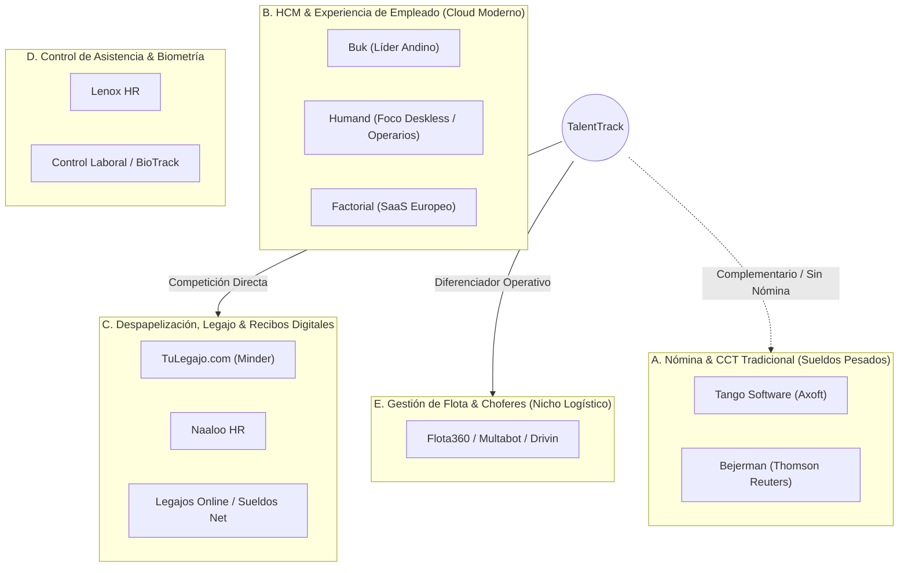

# Investigación de Mercado: Software de RRHH en Argentina y Comparativa vs. TalentTrack

> **Fecha de relevamiento:** Noviembre 2026  
> **Ámbito geográfico:** Argentina (con proyección regional Cono Sur / LatAm)  
> **Enfoque analítico:** Segmento operativo, logística, alimentos, manufactura y servicios  
> **Metodología:** Análisis de oferta comercial, motores funcionales, esquemas de precios y matriz competitiva 1 vs. Todos.

---

## 1. Mapa del Ecosistema de Software de RRHH en Argentina

El mercado argentino de software para gestión de personas y personal operativo se divide en 5 grandes grupos según su madurez y foco:

---

## 2. Radiografía de Competidores Locales y Regionales

### 1. TuLegajo.com (Grupo Minder) — *El estándar en despapelización legal*
- **Foco principal:** Legajo 100% digital y recibos de sueldo con firma digital y electrónica homologada ante el Ministerio de Trabajo (Res. MTEySS 1455/2011 y Ley 25.506).
- **Motores clave:**
  - Motor de distribución y firma masiva de recibos (PDF con certificado criptográfico PKI).
  - Gestor documental de legajos (DNI, contratos, altas de AFIP, títulos).
  - Módulo de licencias y vacaciones con workflows de aprobación multinivel.
  - Alertas de vencimientos generales (documentos y contratos).
- **Modelo de negocio & Precios:**
  - **SaaS por legajo activo mensual.** Cuatro niveles: *Standard, Premium, Corporate, Ultimate*.
  - **Precio estimado:** Cotización cerrada ("hablar con ventas"). Rango de mercado para PyMEs: **US\$ 0,90 a US\$ 2,20 por colaborador/mes** (facturado en pesos al dólar oficial/BNA + IVA). Planes corporativos exigen setup inicial de onboarding.
- **Puntos débiles:**
  - No cuenta con matriz de competencias ni buscador de habilidades previas ocultas.
  - Alertas genéricas de documentos; no dispone de lógica especializada para clases de carnet CNRT ni libretas sanitarias bromatológicas.

---

### 2. Naaloo HR — *El software todo-en-uno para PyMEs argentinas*
- **Foco principal:** Plataforma ágil de gestión humana que combina fichaje de asistencia, legajo online, entrega de EPP y recibos digitales.
- **Motores clave:**
  - Control de asistencia móvil con geolocalización (GPS).
  - Registro de entrega de Elementos de Protección Personal (EPP) conforme a normativa SRT.
  - Calendario de licencias, feriados y ausentismo.
  - Módulo básico de capacitaciones con alertas de vencimiento de cursos.
- **Modelo de negocio & Precios:**
  - **SaaS por empleado activo/mes.** Demo gratuita de 14 días.
  - **Precio estimado:** Entre **US\$ 1,50 y US\$ 3,00 por colaborador/mes**. Venta directa con soporte local.
- **Puntos débiles:**
  - El módulo de capacitaciones es meramente informativo (no tiene actas conformadas con firma digital táctil en pantalla de instructor y alumnos para auditorías de SENASA o ART).
  - No explota el historial de oficios previos de los operarios para cobertura de puestos críticos.

---

### 3. Buk (Argentina / Cono Sur) — *El gigante del HCM integral*
- **Foco principal:** Plataforma "full suite" que cubre desde la liquidación de sueldos con Libro de Sueldos Digital AFIP/ARCA hasta cultura y desempeño.
- **Motores clave:**
  - Motor de liquidación de sueldos parametrizable por convenios colectivos (CCT).
  - LMS / Capacitación continua (cursos en video, cuestionarios y seguimiento).
  - Evaluaciones de desempeño (9-box, feedback continuo, metas OKR).
  - Módulo de clima laboral, encuestas e iniciativas de bienestar.
- **Modelo de negocio & Precios:**
  - **SaaS modular por tramos de empleados.** 
  - **Precio estimado:** Desde **US\$ 3,50 hasta US\$ 6,50 por empleado/mes**, con costos de implementación mandatorios (pueden superar los US\$ 1.500 a US\$ 3.000 según la complejidad de los convenios colectivos a liquidar).
- **Puntos débiles:**
  - Complejidad alta de implementación (toma entre 2 y 4 meses).
  - Sobredimensionado para empresas medianas que buscan una solución ágil enfocada exclusivamente en el personal operativo de planta y flota sin cambiar su sistema contable.

---

### 4. Humand — *La red social y operativa para personal sin escritorio (Deskless)*
- **Foco principal:** Comunicación interna, muro social, avisos y autogestión de turnos para operarios de fábrica, choferes y personal de sucursales.
- **Motores clave:**
  - Muro corporativo tipo red social con likes, comentarios y reconocimientos.
  - Chat interno seguro y chatbot con IA para consultas de RRHH frecuentes.
  - Turnero, fichaje y publicación de recibos de sueldo.
- **Modelo de negocio & Precios:**
  - **SaaS por usuario activo/mes.**
  - **Precio estimado:** Referencia internacional desde **US\$ 2,00 a US\$ 4,00 por usuario/mes**.
- **Puntos débiles:**
  - Excelente para cultura y comunicación, pero carece de rigor legal para auditorías de habilitaciones vehiculares (CNRT), carnets de manipulador de alimentos (BPM) y actas de examen técnico.

---

### 5. Tango Software (Axoft) / Bejerman (Thomson Reuters) — *La vieja escuela contable*
- **Foco principal:** Liquidación de haberes estricta bajo normativa argentina (Libro de Sueldos Digital, Formulario 931, SICORE, retenciones de Ganancias 4ta categoría).
- **Motores clave:**
  - Fórmulas complejas de liquidación por CCT (Camioneros 40/89, Alimentación 244/94, Comercio 130/75, Metalúrgicos UOM).
  - Emisión de recibos en papel o PDF con exportación bancaria de acreditación de sueldos.
- **Modelo de negocio & Precios:**
  - **Licenciamiento tradicional o abono mensual** comercializado exclusivamente a través de red de revendedores autorizados (*partners*).
  - **Precio estimado:** Paquetes base desde **\$300.000 a \$800.000+ ARS mensuales** más horas de consultoría de parametrización.
- **Puntos débiles:**
  - Interfaces anticuadas, pesadas y no preparadas para smartphones en la cabina de un camión o en una planta frigorífica.
  - Desconexión total entre el legajo contable y la realidad operativa de habilidades y vencimientos de seguridad.

---

## 3. Matriz Comparativa: TalentTrack vs. Todos

| Dimensión / Funcionalidad | **TalentTrack (v1.0.01)** | TuLegajo | Naaloo | Buk | Humand | Tango/Bejerman | Flota360 |
|---|:---:|:---:|:---:|:---:|:---:|:---:|:---:|
| **Buscador de Skills Ocultos (Oficios Previos)** | **✅ Nativo (Exclusivo)** | ❌ | ❌ | 🟡 (Genérico) | ❌ | ❌ | ❌ |
| **Semáforo Preventivo 30/15/7 Días** | **✅ Nativo (Color/Severidad)** | ✅ | ✅ | 🟡 | ❌ | ❌ | ✅ |
| **Control Específico Carnets Chofer (CNRT/LNH)** | **✅ Categorías A-E / CNRT** | 🟡 | 🟡 | ❌ | ❌ | ❌ | ✅ |
| **Control Libreta Sanitaria BPM (Alimentos)** | **✅ Nativo Alimentos** | 🟡 | 🟡 | ❌ | ❌ | ❌ | ❌ |
| **Visor Modal de Comprobante / Foto Adjunta** | **✅ Sí (PNG, JPG, PDF)** | ✅ | ✅ | ✅ | ✅ | ❌ | ✅ |
| **Actas de Curso con Firma Táctil en Pantalla** | **✅ Doble Firma + SHA-256** | ❌ (Solo Recibos) | ❌ | 🟡 (LMS web) | ❌ | ❌ | ❌ |
| **Despacho Directo de Alerta a WhatsApp** | **✅ Enlace Directo wa.me** | ❌ (Solo email) | 🟡 (Push app) | ❌ (Email) | 🟡 (Chat) | ❌ | ❌ |
| **Requisitos Obligatorios por Puesto** | **✅ Sí (Dinámico)** | ❌ | 🟡 | ✅ | ❌ | ❌ | ❌ |
| **Portal Móvil para Smartphones (PWA)** | **✅ Sí (Touch Friendly)** | ✅ | ✅ | ✅ | ✅ | ❌ | ✅ |
| **Modo Vehicular (Screen Wake Lock)** | **✅ Nativo** | ❌ | ❌ | ❌ | ❌ | ❌ | 🟡 |
| **Exportación Limpia CSV con BOM UTF-8** | **✅ Nativo Excel** | ✅ | ✅ | ✅ | 🟡 | ✅ | ✅ |
| **Liquidación de Haberes / Sueldos CCT** | ❌ (Fuera de alcance) | ❌ | ❌ | ✅ | ❌ | ✅ | ❌ |
| **Firma Digital con Certificado PKI (Recibos)** | ❌ (Fuera de alcance) | ✅ | ✅ | ✅ | 🟡 | 🟡 | ❌ |
| **Control de Fichaje / Huella / Biometría** | ❌ (Pendiente integración) | 🟡 | ✅ | ✅ | ✅ | ✅ | ❌ |
| **Gestión de Vacaciones con Aprobaciones** | ❌ (Roadmap futuro) | ✅ | ✅ | ✅ | ✅ | 🟡 | ❌ |

---

## 4. Análisis Profundo de Motores

### Motores que tiene la competencia y que TalentTrack NO incluye:
1. **Motor de Liquidación de Sueldos (Payroll Engine):** Cálculo de haberes, descuentos jubilatorios, obras sociales, adicionales de convenio y exportación de Libro de Sueldos Digital para ARCA (ex-AFIP).
   - *Por qué no lo tenemos:* Es un nicho de extrema volatilidad legal e impositiva en Argentina. Requiere un equipo contable dedicado a actualizar paritarias semanalmente. TalentTrack está concebido para ser un complemento operativo de recursos humanos, no un sistema contable.
2. **Motor de Firma Digital Criptográfica Remota con Token/PKI (Ley 25.506):** Envío masivo de recibos de sueldo con certificados emitidos por entes licenciadores (ONTI / Encripter).
3. **Motor de Marcación y Fichaje Horario (Time & Attendance):** Registro de entradas y salidas con foto selfie, geovalla GPS o integración con relojes biométricos ZKTeco.
4. **Motor de Flujos de Aprobación de Licencias (Vacation & Leave Approval Workflow):** Solicitud de días de examen o vacaciones por parte del empleado con aprobación jerárquica por jefes de área.

### Motores que tiene TalentTrack y que la competencia NO incluye (o tiene deficientes):
1. **Motor de Habilidades Previas Ocultas (*Skills Hunter Engine*):**
   - La competencia solo registra el "puesto actual" o hace evaluaciones de desempeño de lo que el empleado ya hace.
   - **TalentTrack resuelve un dolor crítico de plantas operativas:** *"Necesito un soldador urgente porque se rompió una tolva, o un chofer con carnet E para un reparto imprevisto; ¿quién de la nómina tiene esa habilidad previa aunque hoy esté trabajando de peón de carga?"*. El buscador filtra al instante por oficios anteriores con detalle y nivel 1 a 4.
2. **Motor de Cumplimiento Normativo por Puesto (*Position Compliance Engine*):**
   - Evalúa en vivo si cada operario cumple con el 100% de los requisitos legales de su posición (ej. Chofer = Carnet C+E + LNH + Manejo Defensivo; Operaria = Libreta Sanitaria + BPM).
3. **Semáforo Operativo Multi-Industria con Despacho Inmediato por WhatsApp:**
   - La competencia suele enviar correos electrónicos para alertar vencimientos. Los choferes y operarios de planta **no abren correos electrónicos corporativos**. TalentTrack despacha la alerta directamente al WhatsApp del colaborador con el texto legal y los días exactos de urgencia.
4. **Actas de Capacitación en Terreno con Trazo Táctil y Hash Forense:**
   - Permite que el capacitador de bromatología o seguridad e higiene abra la app en una tablet o smartphone dentro del galpón, tome la firma táctil a los operarios en 10 segundos, selle el acta con timestamp y hash SHA-256, y genere el CSV oficial para presentar ante inspectores de SENASA, SRT o auditores de normas ISO.

---

## 5. Modelos de Negocio y Precios en el Mercado

Los esquemas comerciales predominantes en Argentina son:

| Modelo Comercial | Estructura | Precios Típicos en Argentina |
|---|---|---|
| **PEPM (Per Employee Per Month)** | Tarifa mensual fija por cada colaborador en nómina activa. | Entre **US\$ 1,00 y US\$ 4,50** por empleado/mes. |
| **Freemium / Escala PyME** | Base gratuita hasta 5-10 empleados; luego tarifa por tramos (ej. packs de 25, 50, 100). | Packs desde **\$40.000 a \$150.000 ARS/mes**. |
| **Setup & Onboarding Fee** | Cargo por única vez para carga inicial de legajos y configuración de reglas. | Desde **\$100.000 ARS hasta US\$ 1.500** según personalización. |
| **Add-Ons Modulares** | Módulos adicionales con cobro extra (ej. Módulo de flota, Módulo de firma legal). | + 20% a 35% sobre la cuota base. |

---

## 6. Oportunidad Estratégica y Recomendación de Pricing para TalentTrack

### 🎯 La Oportunidad de "Océano Azul": *HR Operativo para Plantas, Logística y Distribución*
- Intentar competir contra Buk o Tango en liquidación de sueldos es un error de alto costo y bajo margen.
- **La oportunidad ganadora de TalentTrack:** Posicionarse como el **SaaS de Gestión Operativa de RRHH y Competencias** para empresas con personal de calle y planta (frigoríficos, lácteas, alimenticias, empresas de transporte, distribuidoras y constructoras) que ya liquidan sus sueldos en Tango o con un contador externo, pero que tienen **los legajos de habilidades, los carnets de conducir y las actas de capacitación tirados en carpetas de papel o planillas de Excel desactualizadas**.

### 💡 Propuesta de Pricing Recomendada para TalentTrack:
- **Plan Operativo PyME (Hasta 25 colaboradores):**
  - **Tarifa plana:** **\$45.000 ARS / mes** (facturación local directa, sin cotizaciones en dólares ni fricción de ventas).
  - Incluye: Legajos completos, Semáforo de vencimientos con WhatsApp, Buscador de Skills, Actas de capacitación con firma digital y exportación CSV.
- **Plan Planta / Logística (26 a 100 colaboradores):**
  - **\$1.500 ARS por colaborador activo / mes**.
  - Incluye: Requisitos de puesto a medida, visor de comprobantes adjuntos y multi-sede.
- **Plan Corporativo (> 100 colaboradores):**
  - Cotización personalizada con SLA y soporte prioritario.

---

## 7. Próximos Pasos Técnicos para Pasar de Prototipo Local a Producto SaaS Comercial

Para llevar TalentTrack al mercado como solución comercial vendible, se deben cubrir los siguientes hitos de infraestructura:

1. **Conexión a Base de Datos en la Nube:** Conectar el Store reactivo actual (que hoy corre en `localStorage` con aislamiento en memoria) a una base de datos multi-tenant real (Cloud Firestore con `firestore.rules` activas o PostgreSQL/Supabase).
2. **Envío de Notificaciones Automatizadas (Cron / Webhook):** Añadir una Cloud Function o cron job serverless que revise a las 8:00 AM los vencimientos del semáforo y envíe recordatorios automáticos por WhatsApp Business API / Twilio sin necesidad de que el operador humano abra la pantalla.
3. **Módulo de Entrega y Control de EPP (Elementos de Protección Personal):** Requerimiento muy demandado en plantas industriales y logística (cascos, botines de seguridad, chalecos refractarios, fajas) con firma de constancia de entrega.